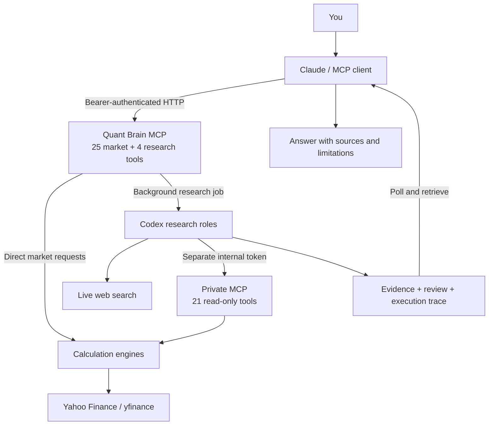

# Quant Brain MCP

**Market calculations and multi-agent research for Claude and other MCP clients.**

Quant Brain combines 25 market tools with four research-job tools. Ask for a quote,
run a backtest, size a hypothetical trade, or start an Indian-equity research job
that coordinates Codex specialists and returns evidence, disagreements, and an
execution trace. Claude reviews the report and explains its judgment to you.

## How it works

The optional research runtime runs locally beside the MCP servers. It uses Codex's
supported sign-in flow; credentials stay with the runtime. Claude receives a
separate MCP bearer token. No Google login is required. There is no order execution.

## Start here

| What you want | Guide |
|---|---|
| Run research locally and connect Claude Code | [Personal research setup](docs/research-runtime.md) |
| Connect Claude Desktop/web or another client | [Getting started](docs/getting-started.md) |
| Deploy authenticated market tools | [Deployment](docs/deployment.md) |
| Understand the system and its boundaries | [Architecture and diagrams](docs/architecture.md) |

For the local research setup, install Python 3.12 dependencies with
`python -m pip install -r requirements_research.txt`, then follow the research
setup guide to generate private tokens, start both servers, and connect Claude.
The base market server only needs `requirements.txt`.

**Claude Code can reach your local HTTP endpoint.** Claude Desktop/web remote
connectors connect from Anthropic's cloud and need a reachable HTTPS endpoint;
they cannot reach your computer's `localhost`. Local Desktop stdio integrations
are a separate connection method and are not configured by this research setup.

The existing hosted endpoint is `https://mcp-quant-brain.onrender.com/mcp`.
It requires an operator-issued bearer token. Its deployed version, research
configuration, and Codex sign-in must be checked separately; a GitHub push or
successful CI run does not verify that hosted deployment.

## The six research roles

| Role | Responsibility |
|---|---|
| Lead | Break the question into a research plan. |
| Company analyst | Investigate the business, filings, and news. |
| Quant analyst | Use calculation tools and identify data limitations. |
| Skeptic | Challenge assumptions and conflicting evidence. |
| Auditor | Review existing claims, request corrections, and retain uncertainty. |
| Synthesizer | Assemble the audited conclusions and unresolved points. |

Company and quant work run in parallel. **Quick** uses four roles/calls;
**standard** adds the lead and skeptic with up to one correction round (6–8 calls);
**deep** permits two correction rounds (6–10 calls). Calls and jobs have timeouts.
Reports persist in owner-scoped SQLite storage; clients poll rather than hold a
single HTTP request open. See the [workflow and lifecycle diagrams](docs/architecture.md).

Example request:

> Use Quant Brain to run quick research on TCS.NS. Check the latest available
> quote and company disclosures. Poll until finished, retrieve the report,
> and give your judgment with source dates, uncertainties, and disagreements.

## What you can use it for

| Ask Claude | What Quant Brain does |
|---|---|
| “Research TCS.NS and explain the strongest counterargument.” | Collects evidence, runs quant tools, challenges claims, and returns an audited report. |
| “Compare RELIANCE.NS and INFY.NS over two years.” | Retrieves historical data and computes requested indicators or backtests. |
| “Size a hypothetical long trade with ₹100,000 equity and 1% risk.” | Calculates entry, stop, shares, targets, and modeled loss with assumptions. |
| “Review this portfolio's historical risk.” | Fits allocation on training history and evaluates frozen weights on held-out observations. |
| “Watch these prices.” | Stores owner-scoped alerts; an external scheduler/client must poll and deliver notifications. |

### From a question to an answer

1. Claude calls `start_research` with your question, 1–5 NSE symbols, and a depth.
2. Quant Brain returns a job ID and runs the specialists in the background.
3. Claude polls `get_research_status`, then fetches `get_research_report`.
4. Claude uses the evidence, audit warnings, and execution trace to explain its judgment.

Use `cancel_research` to stop an owned job. A completed job can still report
`insufficient_evidence`; successful execution does not imply a confident answer.
For direct calculations, Claude calls the market tools without starting agents.

## Tools

| Area | Tools and capabilities |
|---|---|
| Research jobs | `start_research`, `get_research_status`, `get_research_report`, `cancel_research` |
| Trading research | Quotes, news, trade sizing, watchlist scans, persistent price alerts |
| Indicators | Six grouped tools exposing 38 curated indicators |
| Portfolio | Seven optimization methods with chronological holdout evaluation |
| Backtests | Seven rule-based strategy tools |
| Intelligence | Company profiles, sector ranking, sector-to-stock pipeline |
| Charts | Chart packs returned as rendered images |

All **29 tool names, parameters, and response conventions** are documented in the
[tool reference](docs/tools.md). The internal research MCP exposes only 21
read-only tools; alerts, charts, and research orchestration are excluded.

## Validation and limits

The [validated code revision](https://github.com/paarths-collab/quant-brain-mcp/commit/a8c0df1fbf5fe80f2e1a374215c818898a5f8208)
passed **306 tests** in GitHub CI, including PostgreSQL checks, plus HTTP and PNG
export smoke tests. Authenticated quick and deep research runs completed. The deep
run exercised all six roles and both correction rounds, then returned a mixed
result with moderate confidence. Read the [validation report](docs/testing-results.md)
for the tested scope and unresolved limitations.

- **Data freshness:** free data can be delayed or unavailable. `as_of` and
  `fetched_at` are retrieval times, not verified trade timestamps. A recent fetch
  does not establish a fresh market price.
- **Evidence:** SDK traces show that tools ran. They do not independently prove
  every claim, citation, or model-written excerpt. `verification_basis` is
  `model_review`.
- **Backtests:** holdout performance is historical. Costs vary by tool; portfolio
  holdout results omit fees, slippage, taxes, and currency conversion.
- **Trade plans:** sizing limits modeled loss at the displayed stop; gaps,
  slippage, and execution conditions can produce larger actual losses.
- **Scope:** research jobs currently accept NSE symbols. The broader market tools
  also support US and BSE symbols where their providers do. No automatic trading.

## Documentation

- [Architecture, workflow, job lifecycle, and security boundaries](docs/architecture.md)
- [Research runtime, authentication, and Claude connection](docs/research-runtime.md)
- [Tool reference](docs/tools.md) and [example prompts](docs/examples.md)
- [Price alerts](docs/price-alerts.md)
- [Deployment and operations](docs/deployment.md)
- [Dependency maintenance](docs/dependency-maintenance.md)
- [Validation results and remaining limitations](docs/testing-results.md)

## License

[MIT](LICENSE).
