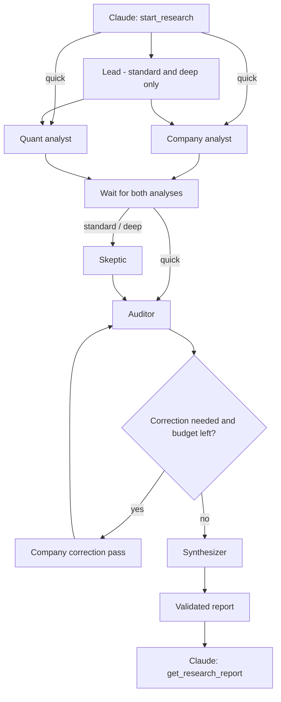

# Agents and tools

This map separates the six implemented Codex roles and their actual tool catalog
from the proposed global research team. Agent roles interpret evidence; Python
tools retrieve data and perform calculations. An agent name is not an MCP tool.

## Current agent roles

Every invocation receives the question, NSE symbols, shared evidence policy, and
findings from earlier completed stages. Company and quant start concurrently
after the optional lead; neither should depend on the other's unfinished output.

| Role ID | Main inputs | Responsibility and typical tool use | Output consumed by |
|---|---|---|---|
| `lead` | Question and symbols | Plan the investigation; avoid unsupported findings. Retrieval is available if needed. | Company, quant, and later reviewers |
| `company` | Question and plan when present | Investigate business quality and disclosures with web search, `get_company_profile`, `get_news`, and `get_quote`. | Skeptic and auditor |
| `quant` | Question and plan when present | Use indicator, backtest, portfolio, sector, quote, and sizing tools; disclose periods, costs, and missing inputs. | Skeptic and auditor |
| `skeptic` | Company and quant findings | Challenge specific investment arguments; use search or analysis tools to investigate counterevidence. | Auditor |
| `auditor` | Prior claims, evidence, and challenges | Review original claim IDs, source support, freshness, units, and calculations. Recheck with available tools as needed. | Correction pass or synthesizer |
| `synthesizer` | Latest audit and prior findings | Assemble supported original claims without inventing or changing claims/evidence; preserve warnings and disagreements. | Final report returned to Claude |

This table describes intended use, **not distinct enforced tool permissions**.
All six roles currently receive the same 21-tool internal allowlist plus Codex
web search. The synthesizer has tool access, but report validation prohibits it
from introducing new claims or evidence. Role-specific allowlists are future work.

A correction is an additional invocation of `company`, instructed to address
all audit challenges, including recalculating quantitative errors. It is not a
seventh permanent agent. The Python workflow schedules roles; agents cannot spawn
nested agents or recursively call `start_research`.

Quick uses four role invocations and no correction. Standard uses 6–8 with at
most one correction/re-audit; deep uses 6–10 with at most two. One research job
executes at a time, with parallel company/quant turns inside that job.

## Current tools and access

### The 21 shared market tools

Both the outer MCP client and internal Codex roles can call these exact names.
The [tool reference](tools.md) contains arguments and response conventions.

| Group | Exact MCP tool names | Purpose |
|---|---|---|
| Quotes and company context | `get_quote`, `get_company_profile`, `get_news` | Price snapshots, company details, and recent headlines |
| Watchlists and sizing | `scan_watchlist`, `build_trade_plan` | Historical signals and hypothetical position sizing |
| Indicators | `analyze_momentum`, `analyze_technical_levels`, `analyze_trend`, `analyze_volatility`, `analyze_volume`, `analyze_statistics` | Six groups exposing 38 indicators |
| Portfolio | `generate_optimized_verdict` | Seven optimization methods with chronological holdout evaluation |
| Backtests | `backtest_macd_momentum`, `backtest_macd_trend_follower`, `backtest_mean_reversion_rsi_bb`, `backtest_rsi_mean_reversion`, `backtest_sma_crossover`, `backtest_trend_crossover`, `backtest_volatility_breakout` | Seven historical strategy tests |
| Sector analysis | `find_sector_stock_pipeline_tool`, `analyze_sector_intelligence_tool` | Sector ranking and sector-to-stock investigation |

### The eight additional outer tools

These bring the outer catalog to 29. They are available to Claude or another
authenticated outer client, but excluded from the internal agent catalog.

| Group | Exact MCP tool names | Purpose |
|---|---|---|
| Research lifecycle | `start_research`, `get_research_status`, `get_research_report`, `cancel_research` | Submit, poll, retrieve, or cancel owner-scoped jobs |
| Charts | `generate_chart_pack`, `generate_charts`, `plot_charts` | Generate chart images; image export needs Chrome |
| Alerts | `price_alert` | Store and check price alerts; requires PostgreSQL and an external polling/delivery process for notifications |

### Runtime capabilities outside the MCP catalog

Codex live web search is enabled separately; it is not one of the 29 MCP tools.
Browser/computer control, shell execution, inherited plugins/connectors, and
nested agent spawning are disabled. Google authentication and order execution
are not part of the current research flow. Web search does not establish a live
exchange price, and model auditing does not independently attest every claim.

## Proposed specialist team and tool permissions

The rows below are a target design, not callable agents or APIs today. Capability
descriptions are deliberately not presented as existing MCP function names.
Implement per-role allowlists before relying on these narrower boundaries.

| Specialist | Proposed tools/capabilities | Required result |
|---|---|---|
| Research lead | Instrument resolution, coverage lookup, task scheduling, budget accounting | Task graph with dependencies and acceptance criteria |
| Filing researcher | Filing search/download, PDF/table extraction, isolated browser navigation | Dated excerpts and financial observations with page references |
| Quant analyst | Quote/candle adapters, current indicators/backtests, interval-aware calculations | Reproducible metrics with inputs, periods, and methodology |
| Valuation analyst | Financial statement normalization, peer comparisons, valuation/scenario calculators | Bull/base/bear valuations with explicit assumptions |
| Macro and sector analyst | Economic series, FX/commodity data, sector tools | Dated macro evidence and an explanation of company exposure |
| Forensic analyst | Filing comparisons, cash-flow reconciliation, governance/disclosure retrieval | Specific inconsistencies and counterevidence, without unsupported accusations |
| Portfolio analyst | Holdings input, currency conversion, exposure/correlation and stress calculators | Portfolio effects under explicit scenarios |
| Skeptic | Read claims/evidence, search for counterevidence, request targeted recalculations | Disputed claim IDs and tests that could resolve them |
| Auditor | Read artifacts and calculation records, deterministic checks, bounded rechecks | Accepted/rejected/unresolved claim assessments with reasons |
| Synthesizer | Read reviewed findings and report assembly | Evidence-backed conclusion, disagreements, invalidation conditions, and next check |

The proposed browser worker serves filing and forensic investigations; it is a
restricted retrieval component rather than an extra decision-making authority.
Likewise the data-quality gate, scheduler, evidence store, and watchlist sentinel
should use deterministic code for freshness, triggers, limits, and bookkeeping.
They need not consume an LLM turn for every event.

## Example of the proposed task graph

For “compare an Indian and a US software company,” resolve listings, currencies,
and reporting periods first. Filing and macro research can then run alongside
technical analysis. Valuation waits for normalized financial statements. Portfolio
analysis runs only if holdings or an allocation question are supplied. Skeptic
and audit stages review the collected findings; synthesis follows those reviews.

This cross-market research request is a roadmap example. Today, use NSE symbols
for research jobs and the broader supported symbols only with individual market
tools. See [architecture](architecture.md#target-global-research-architecture)
and [roadmap](global-research-roadmap.md) for implementation order.
