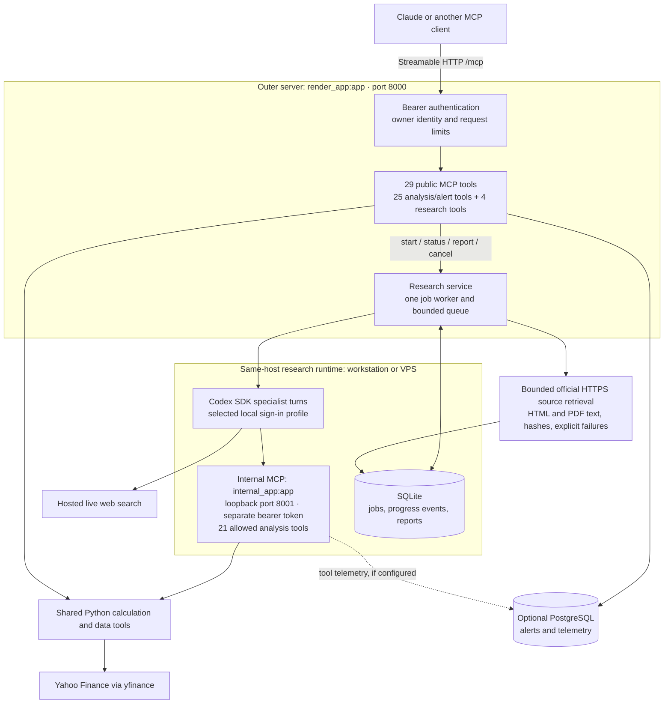
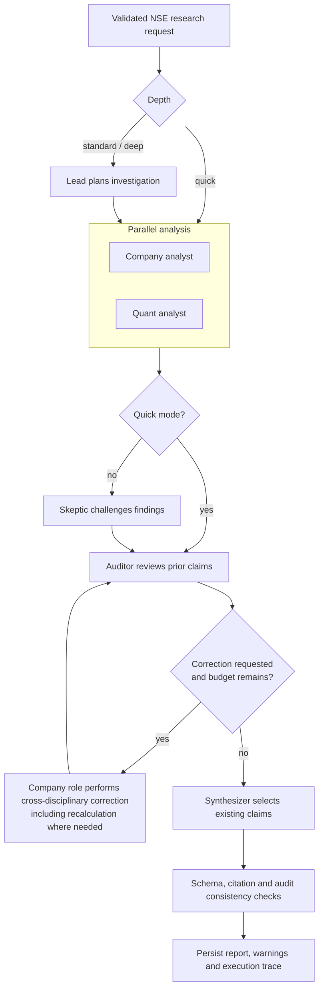
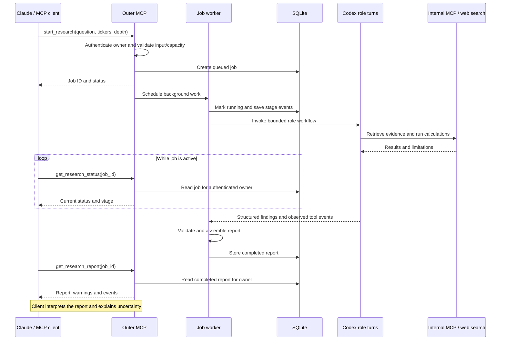
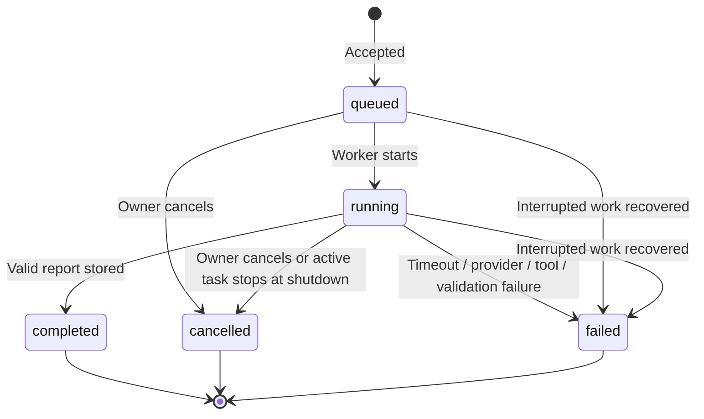
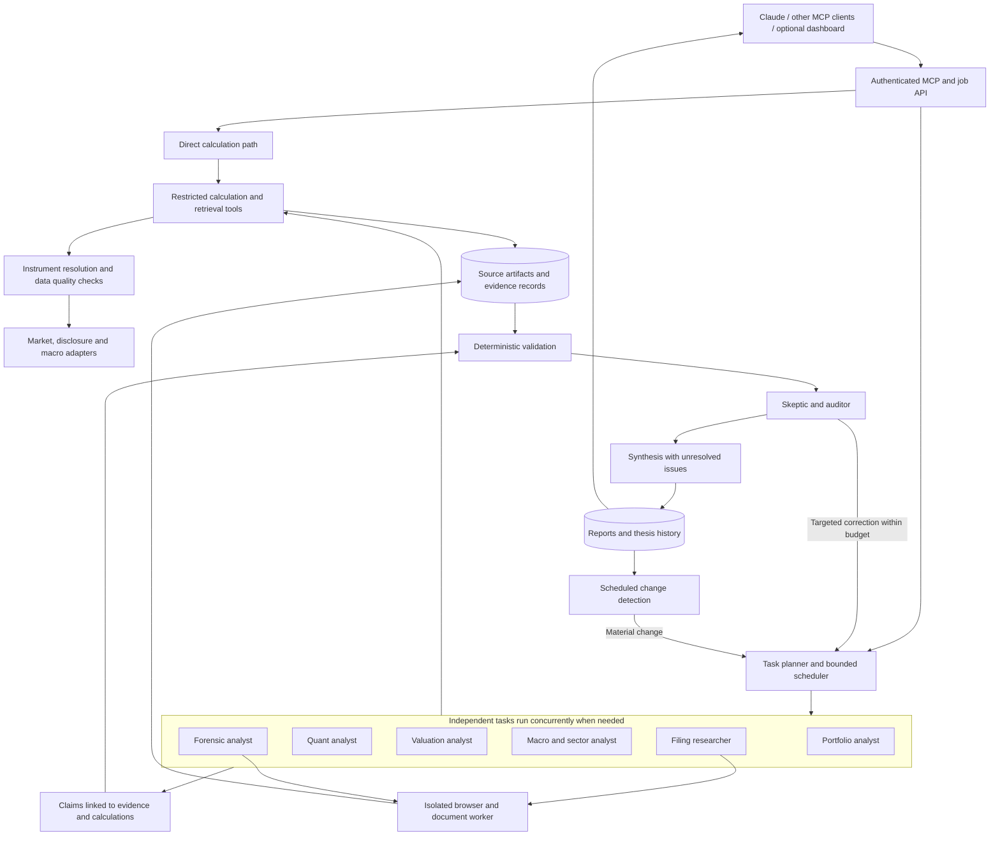

# Current and target architecture

Quant Brain is a Python MCP server for market data, calculations and personal Indian-equity research. A client such as Claude can call individual tools or request a background investigation. The research service runs bounded Codex specialist turns, stores a report, and returns it to the client for interpretation. It does not place orders.

For installation, authentication and Claude connection commands, see the [research runtime guide](research-runtime.md). For hosted HTTP configuration, see [deployment](deployment.md) and the [VPS deployment design](vps-deployment.md).

Sections through the repository map describe the implementation today. The
[target global research architecture](#target-global-research-architecture) at the
end describes proposed extensions. It does not change the current tool schemas,
supported research markets, or runtime permissions.

## System architecture



The two MCP surfaces use the same calculation implementations. The internal surface excludes research orchestration, alert operations and chart tools. Internal researchers therefore cannot recursively start more research jobs or mutate alerts through their MCP tool catalog.

The outer server uses FastMCP's stateless HTTP transport. Research jobs are independent of individual HTTP requests: reconnecting or polling does not end a job. SQLite retains completed reports, but an interrupted job is marked failed on recovery; it is not resumed from its last agent turn.

## Research agents and bounded workflow

The [agent and tool map](agents-and-tools.md) lists exact role IDs, tool names,
inputs/outputs, and the distinction between intended use and enforced access.

The agents are roles implemented by separate Codex turns, not six permanently running services. Python controls their ordering and budgets. Each turn uses a temporary working directory and an ephemeral Codex thread. Model selection is configurable with `QUANT_CODEX_MODEL`; an unset value uses the runtime default.

| Role | Responsibility |
|---|---|
| Lead | Define a focused investigation plan. |
| Company analyst | Research the business, results, announcements and material news. |
| Quant analyst | Use calculation tools for returns, comparisons and risk; disclose periods and assumptions. |
| Skeptic | Challenge the investment argument and retain contradictory evidence. |
| Auditor | Review original claim IDs for source support, freshness, units and calculations; request corrections. |
| Synthesizer | Select existing claims, summarize the audit and preserve disagreements. |



| Depth | Role invocations | Correction budget |
|---|---:|---|
| `quick` | 4 | None: company + quant, auditor, synthesizer. |
| `standard` | 6–8 | Up to one correction and repeat audit. |
| `deep` | 6–10 | Up to two corrections and repeat audits. |

Only company and quant run concurrently. If either fails, the sibling task is cancelled. A correction pass uses the company role with additional instructions to address all audit challenges, including quant errors.

Default limits are 120 seconds per role and 900 seconds per job. `QUANT_CODEX_ROLE_TIMEOUT` accepts 1–600 seconds; the job deadline still applies. At most four queued/running jobs are accepted globally and two per authenticated owner. One job executes at a time. These are invocation, time and queue limits, not a monetary spending cap or a fixed tool-call budget.

## Request and job lifecycle





Terminal states are immutable. Cancellation stops queued work or requests cancellation of the active async workflow and closes the Codex client. It cannot refund model usage already incurred. A synchronous calculation already running in a thread may finish after cancellation; its capacity slot remains held until that thread exits.

An exclusive worker lock allows one outer server worker per research database. ASGI server shutdown closes the job service; FastMCP's per-request lifespan does not. On restart, queued/running records left behind become failed with an interruption message. Starting a fresh job is the recovery mechanism.

## Authentication and trust boundaries

| Boundary | Current behavior |
|---|---|
| Client → outer `/mcp` | `MCP_API_KEYS` maps stable owner IDs to SHA-256 token digests. Missing configuration fails closed. Request parameters cannot choose the authenticated owner. |
| Research/alert ownership | Lookups and mutations are scoped to the authenticated owner. A different owner cannot retrieve a job by knowing its ID. |
| Codex → internal `/mcp` | Separate `QUANT_INTERNAL_TOKEN`, minimum 32 characters, and an explicit 21-tool allowlist. Bind this server to loopback. |
| Codex sign-in | The official runtime handles credentials in the selected `QUANT_CODEX_HOME`. The application does not read or copy credential files. A dedicated profile is the default; an existing profile can be selected explicitly. |
| Inherited local integrations | Runtime overrides clear inherited MCP/plugin tables and disable shell, unified execution, apps, plugins, browser/computer use, host skill discovery and recursive multi-agent features. Live web search and the internal MCP remain available. |
| External evidence | Role instructions treat pages, documents and tool output as untrusted evidence. Model compliance with those instructions is not a proof against prompt injection. |
| Metrics | `/metrics/summary` has its own `METRICS_TOKEN`; `/health` is a basic public process check. Neither proves research/model readiness. |

The outer `/mcp` default is 60 requests per minute per owner with four admitted requests per process. The internal surface uses 120 requests per minute, four active calculation requests and a separate four-stream limit for long-lived GET listeners. Up to eight calculation requests may wait for at most ten seconds. Rate-limit and capacity failures have distinct messages and bounded `Retry-After` values. No entire agent turn is automatically replayed. Both limit request bodies to 1 MiB and body reads to 15 seconds. Browser requests with an `Origin` header require an explicit `MCP_ALLOWED_ORIGINS` match. These controls are per process, not distributed limits.

For remote hosting, configure HTTPS and ingress restrictions as described in [deployment](deployment.md). Keep Codex profiles, runtime environment files, token material, databases and captured research outside the repository. There is no Google OAuth requirement for this local design: the outer MCP bearer credential and the Codex sign-in are separate.

## Evidence and report contract

Each claim references evidence IDs. Evidence contains a source URL or an allowed `urn:tool:quant_internal:<tool_name>`, title, excerpt, retrieval time and optional publication time. Calculation claims require a method. Strict schemas reject unknown fields, conflicting IDs and dangling references. The synthesizer cannot introduce new claim or evidence IDs or alter an existing claim under the same ID.

The latest auditor's assessment bounds the final report. Missing audit support, unresolved correction requests or empty supported conclusions produce `insufficient_evidence` and low confidence. The final confidence cannot exceed the auditor's confidence. Earlier warnings and disagreements remain in the report.

**Verification is model review.** `verification_basis` is explicitly `model_review`. The SDK execution trace records observed web-search events and allowed MCP call names/statuses without prompts, arguments, results or URLs. It shows which tool activity occurred, but does not bind a particular source excerpt or numeric claim to a particular retrieved result. A tool URN identifies a tool; it does not prove execution or factual correctness. Dates and excerpts supplied by a model also require independent checking. Successful tests and agent agreement do not establish investment accuracy.

Before each auditor pass, the server retrieves up to six unique official sources per job, two at a time. The initial allowlist covers NSE, BSE, SEBI, RBI, TCS, Infosys, Reliance and SEC domains. Retrieval validates public DNS addresses, pins the TLS connection to a checked address, and revalidates redirects. It forwards no application credentials or environment proxies. A whole-fetch worker has a 26-second deadline; network content is limited to 2 MiB. PDF parsing occurs in a separate resource-limited process (10 seconds, first 20 pages, at most 16,000 characters; CPU and Linux memory limits). Scanned PDFs requiring OCR, blocked sites, larger files and other domains remain explicit gaps. Cancellation can leave a bounded worker finishing until its deadline.

`source_retrievals` retains server-owned retrieval times, document hashes, extracted text, truncation and failures separately from model-authored evidence. Explicit HTML publication metadata is labeled `publisher_metadata`; missing or conflicting dates remain null, and PDF creation dates are not treated as publication dates. Retrieved text does not establish that a claim is true. `execution_status` distinguishes `observed_calls_passed`, `partial_failure` and `not_observed`; tool payload errors count even when transport succeeds. Failed calls or failed cited retrievals lower confidence to low and prevent a supported outcome. Unknown source dates and unavailable official text prevent high confidence. Server-enforced summary wording reflects these downgrades; original model prose remains in `agent_findings`.

## Data and calculation conventions

| Area | Convention or limitation |
|---|---|
| Research market | 1–5 NSE symbols, normalized to `.NS`; reports identify INR and `Asia/Kolkata`. Individual analysis tools may support additional markets. |
| Historical bars | Shared yfinance loaders request `auto_adjust=True`, incorporating dividend/split adjustments in OHLC prices. |
| Quote freshness | `as_of` and `fetched_at` are retrieval times. The quote tool returns `market_timestamp: null` and `freshness_status: unknown`; retrieval time is not an exchange observation time. Provider delay notes are not a freshness guarantee. |
| Profile units | Debt/equity is returned as both percent and times; legacy fields are explicitly percent. Missing metrics remain null. Provider data availability is not a calibrated confidence score. |
| Indicator metadata | All 38 indicators disclose settings, units, engine versions, history range and adjustment. Empty recent values are explicit errors; freshness and daily-bar completeness remain unknown. |
| Annualization | 252 trading days for the shared trading-year convention. |
| Backtests | Inspect each response's benchmark, sample period and cost assumptions. Strategy backtests and portfolio holdout evaluation do not share identical cost models. |
| Web search | Research evidence, not an exchange-grade live-price feed. |
| Missing data | Provider outages, stale observations and incomplete inputs can make a result unavailable or insufficient. |

Portfolio optimization fits weights on the earliest 70% of aligned history and evaluates frozen weights on the latest 30%. It requires at least 126 training and 63 holdout observations. Purchases occur at the first holdout close; no return is credited across the training boundary. Returned weights are the historical training allocation, not a refit on all available data.

The historical verdict uses holdout performance only. Full-history alpha and risk fields are descriptive diagnostics and cannot upgrade that verdict. Response metadata discloses dates and unmodeled costs. A single holdout is not walk-forward validation or evidence of future returns.

## Storage and observability

| Store | Contents and behavior |
|---|---|
| SQLite (`QUANT_RESEARCH_DB`) | Owner-scoped questions, symbols, status, progress events and completed reports. WAL mode; newly created database files use private permissions. Persistence needs a durable filesystem. No automatic retention/deletion policy is implemented. |
| Optional PostgreSQL (`DATABASE_URL`) | Persistent price alerts and tool telemetry. Research jobs do not depend on PostgreSQL. |
| Telemetry queue | Bounded in-process queue with a background PostgreSQL writer. Delivery is best effort; queue overflow or storage failure can lose events. |

Tool telemetry includes name, category, duration, success, a truncated error when present, and a session identifier. The identifier is an MCP session header when available or a hash derived from client IP and user agent. This is not a guarantee of anonymous data: errors and session metadata should be treated as potentially sensitive. The instrumentation is designed to keep telemetry failures from failing tool calls.

The research execution trace is separate from tool telemetry. It is saved with a completed report; failed jobs expose safe error messages and stage events rather than a guaranteed complete execution trace.

## Repository map

```text
render_app.py              Outer authenticated ASGI app and server lifecycle
fastmcp_server.py          29 public tools, health/metrics routes, bounded dispatch
internal_app.py            Restricted 21-tool internal MCP
research_cli.py            Codex login and authentication-readiness helper
core/
  http_security.py         Bearer identities and HTTP admission limits
  research_service.py      Queue, worker lock, cancellation and job deadline
  research_store.py        SQLite jobs, reports and progress events
  research_workflow.py     Role ordering, schemas and report validation
  research_runtime.py      Codex SDK configuration, turn limits and execution trace
  research_tools.py        Internal tool allowlist
  data_loader.py           Historical market-data retrieval
  indicator_registry.py    Curated indicator groups
  quant_settings.py        Trading-year convention
  telemetry.py             Best-effort PostgreSQL instrumentation
tools/                     Market, indicator, backtest and portfolio implementations
tests/                     Unit, integration and regression coverage
docs/                      Setup, API, architecture and operational guidance
```

The implementation is a single-host research system. Distributed job scheduling, automatic crash resumption, independently attested claim provenance, guaranteed real-time exchange data and order execution are outside its current scope. Test outcomes document tested behavior; they do not remove these limitations.

## Target global research architecture

Status: proposed design. Keep the Python calculation engines and MCP interface,
then add provider contracts, isolated research workers, and evidence storage in
stages. The current single-host system remains the starting point; no new
orchestration framework or distributed queue has been selected or implemented.



### Global instrument and observation contracts

Resolve a security to a stable instrument identity plus exchange, listing, and
currency before retrieving data. Preserve provider symbols as mappings rather
than universal identifiers. Apply exchange calendars and time zones to session
boundaries, closed markets, and extended hours.

Each observation should retain its source, provider coverage, market timestamp,
retrieval timestamp, interval, currency/unit, adjustment policy, and freshness
assessment. Financial observations additionally need reporting period,
publication/availability dates, consolidated or standalone basis, and restatement
version. Missing timestamps remain unknown; a fallback provider must disclose
changed coverage or delay. Minute-bar tools require interval-aware calculations,
not merely a new parameter on formulas that assume daily observations.

Implement India and US adapters first, then additional markets against the same
contracts. Account entitlements and redistribution permissions belong to each
adapter's configuration and documentation. See [candidate data sources](global-research-roadmap.md#global-market-foundation).

### Browser and document boundary

Use APIs first, direct document parsing second, and browser interaction when a
site requires it. The browser worker should have an isolated session, narrowly
scoped navigation/extraction operations, resource limits, and controlled download
storage. Block access to local/private network services and keep Codex profiles,
broker credentials, and user files outside its reach. Pages and downloaded files
are untrusted evidence, not instructions to execute or a reason to expand access.

Return source URL, document and retrieval dates, page/section references, extracted
passages, and artifact identifiers where retention is permitted. A document hash
helps detect changes; it does not prove the document's truth. Browser research
must not masquerade as an exchange-grade streaming quote source. These controls
need implementation and adversarial testing before enabling browser access.

### Planning and parallel execution

The lead selects only the specialists needed for a question. Filing, quantitative,
valuation, macro, forensic, and portfolio tasks may run concurrently when their
inputs are independent. A valuation task that needs extracted statements waits
for that extraction. Skeptical review follows findings; targeted corrections can
reopen specific tasks within a shared budget.

Simple quote and calculation requests bypass the research team. The proposed
scheduler needs bounded per-owner/global concurrency, provider rate limits,
cancellation, retry policies, checkpointed progress, and time/cost accounting.
Resumption and multi-job parallelism are future work; the current worker executes
one job at a time and fails interrupted jobs on restart.

### Evidence and verification contract

Store a claim's supporting artifact or observation IDs, exact passage or numeric
inputs, calculation method/version, objections, and verification status. Mark
results as sourced, calculated, inferred, or unresolved. Deterministic checks
should validate units, periods, arithmetic, freshness, and evidence references;
models assess interpretation and competing explanations.

A critic must identify the challenged claim and a test that could resolve it.
Agreement between models is not independent verification. Review exhaustion
produces a report with unresolved issues rather than automatic acceptance.
Current SDK traces remain useful execution records but cannot substitute for
the proposed links between claims and captured results.

### Memory and ongoing research

Thesis history should preserve conclusions, assumptions, supporting evidence,
invalidation conditions, and next review events. Change detection should trigger
focused work only when material evidence changes, with deduplication and an
explicit notification destination. Saved reports and existing price-alert rows
do not yet provide this behavior.

Historical replay must enforce information availability at the selected time,
including restatements and delistings. Portfolio scenarios must state shocks,
currency conversion, exposure assumptions, and limitations. Neither capability
is supplied by the current portfolio optimizer alone.

### Delivery and acceptance

Ship provider contracts and freshness checks before adding more analyst roles.
Evaluate instrument resolution, extraction, citation support, reproducible
calculations, leakage, and failure recovery. Measure latency and cost, and publish
failure cases alongside successes. See the [delivery sequence and evaluation plan](global-research-roadmap.md#recommended-delivery-order).

User-selected models, a credential-free demo, provider plugins, packaged
installation, and an evidence dashboard are planned adoption improvements. The
current runtime uses Codex; a generic model-provider interface is not implemented.
Order execution is outside both the current system and this research roadmap.
