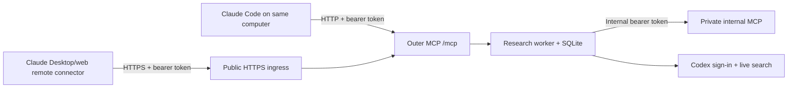

# Deployment and release checks

This revision requires authenticated HTTP access. It does not change an existing hosted deployment until deployed. Use an MCP client that can set an `Authorization: Bearer ...` header. The server uses operator-provisioned API tokens; it does not implement an OAuth login or account signup flow.

## Choose a deployment mode

For personal research on Hostinger or another persistent Linux host, use the
[VPS deployment design](vps-deployment.md): supervised outer/internal services,
on-host Codex sign-in, durable storage, and HTTPS ingress. This is separate from
the [proposed global architecture](architecture.md#target-global-research-architecture);
deploying the current code does not enable browser workers or broker feeds.

| Mode | Processes and dependencies | Intended use |
|---|---|---|
| Market tools only | Outer HTTP server, base Python dependencies; PostgreSQL for alerts/telemetry | Authenticated quotes, calculations, charts, and backtests |
| Personal research | Outer server + private internal server + optional Codex runtime + persistent SQLite | Claude delegates NSE research to bounded specialist roles |

The checked-in `render.yaml` installs the **base** requirements. It does not configure
research agents, Codex sign-in, an internal MCP process, or durable SQLite storage.
Use [research setup](research-runtime.md) to provision those separately. The current
research worker uses POSIX file locking; the verified local setup is macOS, and CI
runs Linux. A native Windows research worker is not validated.

Only the outer endpoint belongs behind public ingress. Keep the internal endpoint
private; default bind is loopback. Configure persistent storage for research jobs
before using a host with an ephemeral filesystem. Do not share a research database
between multiple outer workers: the service deliberately holds an exclusive lock.

## Configuration

The complete environment reference is [.env.example](../.env.example). It contains
no real secrets and is not loaded automatically. The [VPS installer](../scripts/setup-personal-vps.sh)
generates private exported server/client configuration files outside the checkout;
optional settings can be edited there before restarting the services.

- Python 3.12; install the tested `requirements.lock` and provision Chrome for Kaleido image export (see README).
- `MCP_API_KEYS`: JSON mapping stable, non-personal owner IDs to lowercase SHA-256 digests of random bearer tokens. Generate at least 32 random bytes per token with a secure secrets generator. Supply the raw token only to its intended client through a secret manager, and store its digest in the server configuration. Never commit either value. Rotate a token by replacing its digest while retaining the owner ID, then restart workers.
- `DATABASE_URL`: PostgreSQL connection URL, required for durable alerts. Use TLS for remote databases and a dedicated database role. The application creates its tables/indexes on first use; run the first connection under controlled deployment conditions. Existing alerts with no owner remain inaccessible; assign ownership only after an operator verifies it.
- `METRICS_TOKEN`: separate random credential for the metrics endpoint.
- `MCP_ALLOWED_ORIGINS`: optional comma-separated exact browser origins. Browser requests are rejected by default. Native clients without an Origin header are supported.
- `HOST`, `PORT`: bind configuration. Use TLS at the ingress; do not expose plaintext HTTP publicly.

Start with `uvicorn render_app:app --host 0.0.0.0 --port "$PORT"`. Running `python fastmcp_server.py` uses the same protected application. Missing API-key configuration returns HTTP 503 on `/mcp`; missing/invalid credentials return HTTP 401. `/health` is liveness only and remains public; it does not certify database or Yahoo availability.

Each worker permits 4 concurrent authenticated MCP requests and 60 requests per minute per owner. HTTP bodies are capped at 1 MiB with a 15-second read timeout. Calculation calls have a separate four-slot limit retained even if a client disconnects. Research has its own queue: at most four queued/running jobs globally, two per owner, and one job executes at a time. Research accepts 1–5 NSE symbols; many market tools accept up to 25 tickers or indicators per call. These are per-process safeguards: configure shared rate limiting, request-size limits, and timeouts at your production ingress when running multiple workers. Blocking analysis runs in threads so health checks remain responsive. Upstream data availability and numerical job duration are not guaranteed.

## Verification

Run the unit/regression suite, the offline smoke test (including PNG export), and the opt-in database integration tests described in their test module. Run representative authenticated live quote, indicator, portfolio, and chart requests in staging. Verify that a second identity cannot list, delete, or trigger the first identity's alerts. Check missing/wrong-token behavior before enabling public ingress.

A successful test suite is not a load, penetration, or investment-model certification. Portfolio results are historical research estimates; inspect the returned holdout methodology and limitations. Real database durability, ingress controls, and alert-polling credentials must be configured and tested for each deployment.

## Research configuration

| Variable | Default / meaning |
|---|---|
| `QUANT_RESEARCH_ENABLED` | Off; set `true` or `1` to enable research jobs |
| `QUANT_INTERNAL_TOKEN` | Required shared secret, at least 32 characters; distinct from client tokens |
| `QUANT_INTERNAL_MCP_URL` | `http://127.0.0.1:8001/mcp`; remote addresses require HTTPS |
| `QUANT_CODEX_HOME` | `~/.quant-brain/codex`; explicitly select an existing signed-in profile to reuse it |
| `QUANT_CODEX_MODEL` | Unset; the Codex runtime selects its default |
| `QUANT_CODEX_ROLE_TIMEOUT` | 120 seconds per role; allowed range 1–600 |
| `QUANT_RESEARCH_DB` | `~/.local/share/quant-brain/research.sqlite3` |

The complete running job has a 900-second budget; queue wait is separate. There is
no automatic resume after restart: abandoned queued/running jobs become failed
with stage `interrupted`. Completed reports remain readable. Poll using the same
owner's bearer token; knowing a job ID is not authorization.

## Operational checks

| Symptom | Check |
|---|---|
| HTTP 503 on `/mcp` | Valid `MCP_API_KEYS` are required; `/health` alone is insufficient |
| HTTP 401 | Client bearer token must match a configured SHA-256 digest |
| HTTP 429 / queue full | Reduce concurrent work, wait, or cancel an owned job |
| Research disabled | Set the opt-in flag and install `requirements_research.txt` |
| Codex not signed in | Run the documented account check with the same selected profile |
| Research worker already active | Use one outer worker per SQLite database |
| Job failed after restart | Read its error; explicitly submit a new job if still needed |
| Chart image unavailable | Provision Chrome for Kaleido and run `python smoke_test.py` |

Back up PostgreSQL and SQLite according to their database tooling; protect backups
as private data. Research stores questions, selected symbols, model findings,
reports, and execution metadata. Optional telemetry stores call metadata and
errors. Set your own retention policy; there is no built-in report purge tool.
