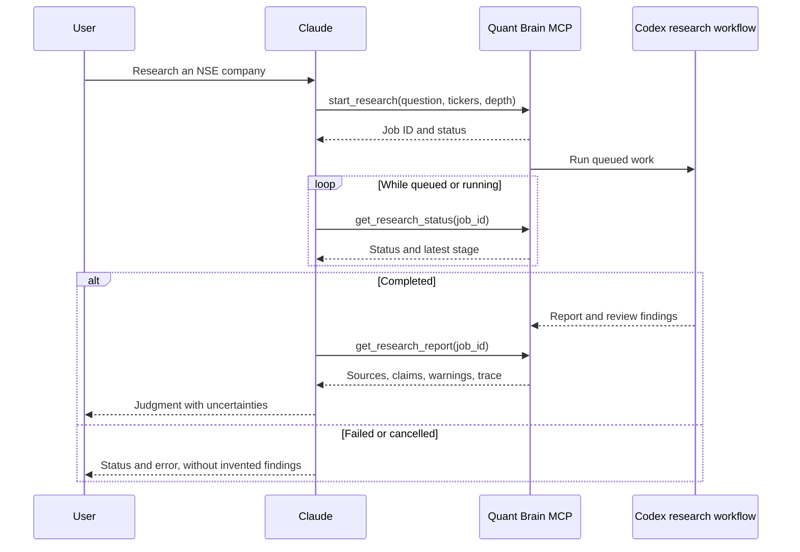
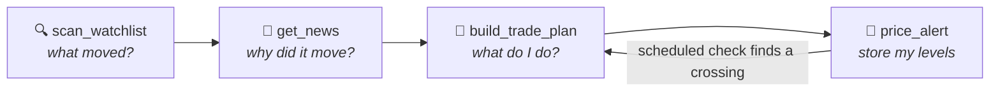

# Example Prompts

Use these prompts after connecting your client with the [research runtime guide](research-runtime.md). The [tool reference](tools.md) lists exact arguments; [Architecture](architecture.md) explains how the agents and calculation server work.

Research prompts below require the optional Codex runtime. Direct analysis prompts work without it.


## Agent research in Claude

> "Use Quant Brain to research TCS.NS in standard mode. Examine its latest available results, business risks, and valuation. Poll the job until it finishes, show its sources and observation dates, preserve disagreements, then give your own conditional judgment."

> "Run quick research comparing TCS.NS and INFY.NS. Separate facts from interpretations. If fresh data is missing, say what is missing instead of guessing."

> "Run deep research on RELIANCE.NS. Ask the skeptic to challenge the strongest argument and show which claims the auditor accepted or rejected. Explain what would change the conclusion."

> "Check the status of the research job you just started."

> "Cancel the research job you just started."

### The calls behind a research prompt

These are illustrative tool arguments, not fabricated research results. Pass the actual returned `id` into later calls; `<returned-id>` is a placeholder.

1. Call `start_research`:

   ```json
   {
     "question": "Assess TCS business quality and the risks in its latest available results. Show reporting dates and missing evidence.",
     "tickers": ["TCS.NS"],
     "depth": "standard"
   }
   ```

2. Call `get_research_status` with `{"job_id": "<returned-id>"}` periodically, for example every 5–10 seconds. Keep the same ID instead of submitting duplicate jobs. Honor HTTP `Retry-After` when rate-limited.
3. When status is `completed`, call `get_research_report` with the same argument. When it is `failed` or `cancelled`, explain the status and any error; there is no finished report to summarize.
4. If cancellation is requested, call `cancel_research` with the same argument.



A completed job does not imply a positive investment conclusion. `insufficient_evidence` is a valid result. Auditor checks are model reviews; execution records establish tool activity, not independent fact verification. Ask Claude to inspect cited sources and flag unknown quote freshness.

## The daily loop



## One-liners

> *"What's RELIANCE trading at?"*

> *"Any news on HINDALCO?"*

> *"Is TCS overbought?"*

> *"Where is AAPL relative to its 200-day moving average?"*

## The Sunday scan

> *"Scan my watchlist — RELIANCE, TCS, HDFCBANK, HINDALCO, SUNPHARMA — and tell me which names actually did something this week. For anything interesting, check the news too."*

## Trade planning

> *"Build me a trade plan for HINDALCO.NS. ₹2,00,000 equity, 1% risk."*

> *"Same but short, and use 2% risk."*

> *"Plan a long on NVDA with $25,000 — and tell me if my order size would move the market."*

## Price alerts

> *"Alert me if RELIANCE drops below ₹1,270 — that's my stop."*

> *"What alerts am I watching?"*

> *"Delete alert 3."*

Alerts are stored, but the server does not send proactive messages by itself. A separately configured scheduler must call `price_alert` with `action: "check"` and deliver notifications. See [Price Alerts](price-alerts.md).

## Strategy validation

> *"Does a 50/200 SMA crossover actually beat buy-and-hold on TCS? Test it over 5 years."*

> *"Backtest RSI mean reversion on HDFCBANK with 25/75 thresholds instead of the defaults."*

> *"Compare MACD momentum vs volatility breakout on RELIANCE over 10 years — which held up better and why?"*

## Portfolio construction

> *"Optimize a portfolio of INFY.NS, TCS.NS, HCLTECH.NS with ₹5,00,000. Use CVaR and show the training/holdout dates, drawdown, and limitations."*

> *"Same tickers, but compare max Sharpe vs HRP allocations and explain the difference."*

> *"Give me the full verdict on INFY, TCS, HCLTECH over 5 years — and flag anything risky."*

## Sector rotation

> *"Which Indian sector has the best risk-adjusted performance over the last year? Show the correlation matrix too."*

> *"Find the best Indian sector, pick the top stocks inside it, backtest MACD on the winner, and give me a sized trade plan with ₹3,00,000 at 1% risk."*

That prompt can combine the sector/stock pipeline, a backtest, and a trade plan. Add `get_news` when you also want recent headlines; each stage should disclose its inputs and dates.

## Charts

> *"Chart RELIANCE over 2 years with the full institutional pack."*

> *"Plot portfolio diagnostics for AAPL, MSFT, GOOG."*

## Power-user notes

- Indicator, strategy, portfolio, watchlist, and trade-plan tools use `period`. Charts and sector intelligence use `timeframe`; quote, news, profile, alert, and research job tools do not take `period`.
- Indicator tools take subsets: *"just RSI and MACD"* avoids computing all eight.
- Mixed US + India portfolios work; the verdict includes an `fx_note` reminding you currency risk isn't modeled.
- Ask *"why?"* after any result and request its actual tool inputs, reporting period, and calculation method. Missing information must remain explicit.
- Quote `as_of`/`fetched_at` fields record retrieval time; they do not establish when the market price was observed.
- A trade plan is a calculation, not an order. Its `max_loss` assumes execution at the stop; actual losses can exceed it.
