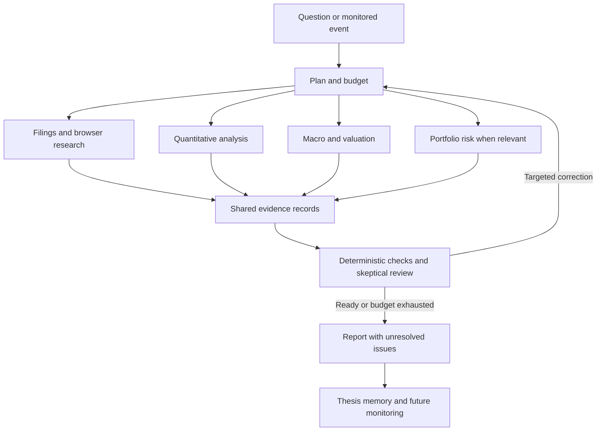

# Global market research roadmap

Status: proposed future work, saved for later on 16 October 2026. This roadmap does not change the running application.

Build Quant Brain into an open-source research desk for India, the US, and other markets. Agents should investigate companies, inspect websites and filings, run calculations, challenge conclusions, and monitor subsequent changes. Every material conclusion should link to evidence and reproducible calculations.

## Current baseline

The project exposes 29 outer MCP tools and 21 private read-only research tools. Its six research roles are lead, company researcher, quant analyst, skeptic, auditor, and synthesizer. Company and quant research can run in parallel; later review stages depend on those results. Separate research jobs currently execute one at a time.

The Codex runtime supports web search and restricted calculation tools. Browser control is disabled. Research jobs are NSE-only; individual market tools can use other provider-supported symbols. Evidence verification is model review, not independent proof of every claim. There is no broker live-feed integration or automated trading.

See [the runtime guide](research-runtime.md) for current operation and [validation results](testing-results.md) for tested scope.
The [architecture specification](architecture.md#target-global-research-architecture)
defines proposed boundaries and data contracts; the [agent and tool map](agents-and-tools.md)
distinguishes exact current tool names from future capabilities. For the current
release on a server, see [VPS deployment](vps-deployment.md).

## Global market foundation

Create a provider-independent instrument and observation model:

- Exchange and instrument identity, including dual listings and symbol changes.
- Currencies, exchange calendars, time zones, and regular or extended trading sessions.
- Splits, dividends, delistings, and adjusted versus unadjusted history.
- Financial statement units, fiscal periods, and consolidated versus standalone results.
- Source, market timestamp, retrieval timestamp, data coverage, and freshness status.
- Publication and availability timestamps so historical research cannot see future information.

Use interchangeable adapters rather than assuming one data provider covers everything.

| Market | Initial adapter scope |
| --- | --- |
| India | Broker quotes and candles; exchange disclosures and company filings. |
| US | SEC filings and structured company financials; a separate market-data feed. |
| Other markets | Country-specific providers, calendars, financial reporting conventions, and disclosure sources. |

Upstox documents [real-time WebSocket data](https://upstox.com/developer/api-documentation/v3/get-market-data-feed/) and [intraday candles including one-minute intervals](https://upstox.com/developer/api-documentation/v3/get-intra-day-candle-data/). The SEC provides [company submissions and extracted XBRL data](https://www.sec.gov/search-filings/edgar-search-assistance/accessing-edgar-data).

Free feeds must retain explicit coverage labels. For example, Alpaca documents free live IEX coverage and subscription access to consolidated live SIP data; those feeds must not silently appear equivalent. See [Alpaca's market-data FAQ](https://docs.alpaca.markets/us/docs/market-data-faq). Provider access, entitlements, and redistribution permissions need checking for each integration.

## Browser research worker

Add an isolated browser worker that can navigate investor-relations sites, find results presentations, download filings, inspect earnings transcripts, extract PDF tables, and investigate announcements.

Use structured APIs first, document extraction second, and browser interaction when needed. Each result should include its URL, document date, retrieval time, relevant passage, page number when applicable, and a saved reference where permitted. Treat website content as evidence, never as instructions to the worker. Keep browser access separate from credentials, private files, and trading actions.

Browser interaction supplements research; it is not the source of a reliable streaming price feed.

## Specialist roles

| Role | Responsibility |
| --- | --- |
| Research lead | Break questions into tasks and allocate time and cost budgets. |
| Filing researcher | Analyse statements, disclosures, and management commentary. |
| Quant analyst | Run technical analysis, statistics, and strategy tests through calculation tools. |
| Valuation analyst | Build comparable valuations and explicit bull, base, and bear scenarios. |
| Macro and sector analyst | Examine rates, currencies, commodities, and industry conditions. |
| Forensic analyst | Investigate cash-flow inconsistencies, dilution, governance concerns, and accounting changes. |
| Portfolio analyst | Assess concentration, correlations, currency exposure, and downside scenarios. |
| Skeptic and auditor | Challenge specific conclusions, check evidence, and request targeted corrections. |
| Synthesizer | Explain audited findings, disagreements, assumptions, and remaining uncertainty. |

Activate only roles relevant to the question. A quote request should use one tool call. A substantial company investigation can launch independent specialists concurrently, then run dependent review stages. Bound concurrency, retries, correction rounds, and total cost.

## Evidence verification

Record each material claim with supporting sources, exact passages or data, calculation inputs and versions, objections, and verification status. Label conclusions as calculated, directly sourced, inferred, or unresolved.

Use deterministic checks for arithmetic, units, dates, freshness, and citation references. Require critics to identify a disputed claim and propose a specific test. Agent agreement alone does not establish truth. Keep unresolved disagreements visible when the review budget expires.

## Standout user experiences

### What changed

Save investment theses, evidence, risks, invalidation conditions, and next review events. Compare new information with that history and explain which assumptions strengthened or weakened. A watchlist sentinel should trigger focused research on material changes, avoiding duplicate notifications.

### Replay this decision

Reconstruct analysis using only information available on a selected historical date. Preserve original publication times, subsequent restatements, source versions, and data availability to prevent hindsight leakage.

### Stress my portfolio

Explore explicit scenarios such as currency depreciation, margin contraction, or sector drawdowns. Show assumptions, exposures, estimated effects, and limitations rather than presenting scenarios as forecasts.

Every substantial report should contain a conclusion, evidence and timestamps, disagreements, invalidation conditions, and the next useful check.

## Public evaluation and quality

Publish repeatable evaluations for ticker and exchange resolution, stale or conflicting prices, financial table extraction, unit conversion, citation accuracy, unsupported claims, browser prompt injection, and failure recovery.

Test backtests for information leakage, survivorship bias, transaction costs, and benchmark alignment. Maintain timestamped forecasts with their horizons and subsequent outcomes. Report research latency and cost as well as quality. Model confidence is not a validated probability of investment success.

## Open-source operation

Keep the existing Python and MCP core. Add a separate browser worker, resumable jobs, and documented provider interfaces. Prioritize:

- Docker Compose installation and a connection diagnostic.
- A demo mode that needs no credentials.
- User-selected model and market-data providers.
- An optional dashboard for evidence, progress, and disagreements.
- Clear licensing, contribution guides, and sample provider plugins.
- Separate user credentials and private research storage.

## Recommended delivery order

1. Finish deployment and verify the complete Claude connection.
2. Establish global instrument and observation contracts, including freshness checks.
3. Add reliable India and US adapters and interval-aware calculations.
4. Add browser and filing research with evidence capture.
5. Strengthen deterministic verification and publish an evaluation suite.
6. Add thesis memory, scheduled monitoring, and change reports.
7. Add portfolio scenarios and historical decision replay.

The intended experience is: ask a difficult market question, inspect the research and evidence, and keep tracking whether the conclusion still holds.
