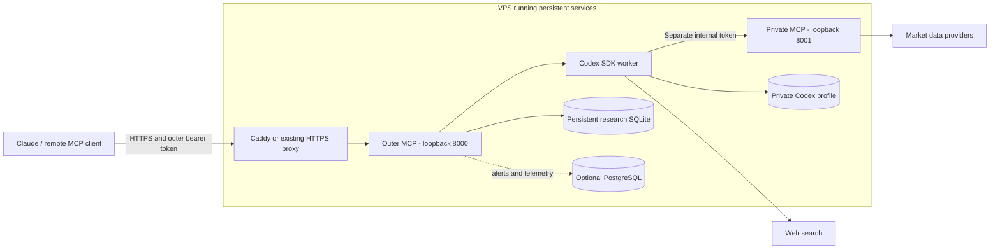

# Personal research on a VPS

This is a deployment design and operator checklist for the current release,
including a Hostinger VPS. The optional [Ubuntu installer](../scripts/setup-personal-vps.sh)
creates the application user, installs dependencies, generates private credentials,
and writes two systemd units. It does not sign in, start services, or configure
public ingress. No Docker Compose deployment is shipped. Proposed global research features are documented
separately in the [roadmap](global-research-roadmap.md).

## Topology



Only the outer server belongs behind HTTPS ingress. Keep both application ports
bound to loopback and do not expose the internal MCP publicly. A remote Claude
connector uses the public hostname, not the VPS's `127.0.0.1` address.

## Prepare the host

For a first installation on an existing Ubuntu 24.04 VPS, copy
`scripts/setup-personal-vps.sh` to the server, inspect it, and run it as root with
`bash setup-personal-vps.sh`. It refuses an existing `quant` user/home, existing
service names, or occupied ports 8000/8001. It installs packages without requesting
a system upgrade and leaves Traefik, DNS, and firewall configuration alone. If it
fails partway through, inspect the error and partial installation before retrying;
it deliberately does not overwrite an existing application identity.

The installer uses `/home/quant/quant-brain-mcp`, stores server configuration in
`/home/quant/.config/quant-brain/runtime.env`, and saves the separate client token
in a private `client-token` file in that directory. It prints no secrets.
It also creates `client.env` containing only the outer token for CLI clients.
The generated server configuration includes all application environment settings,
with optional model, PostgreSQL, and browser-origin settings left empty. A separate
metrics token is generated automatically. See [.env.example](../.env.example) for
the full documented reference; it contains no working credentials.

To install directly from GitHub at a root VPS prompt, download the script first:

```sh
curl -fL https://raw.githubusercontent.com/paarths-collab/quant-brain-mcp/main/scripts/setup-personal-vps.sh -o /root/setup-personal-vps.sh
bash /root/setup-personal-vps.sh
```

Run the second command only after the download succeeds. For a reproducible
installation, use a reviewed commit SHA instead of `main` in the download URL.
The installer clones the repository's default branch; record the resulting
checkout revision as part of deployment verification.
Its syntax has been checked locally; actual VPS installation and the acceptance
checks below still need execution on the target machine.

Ubuntu 24.04 with Python 3.12 is a suggested starting environment. Two vCPUs and
4 GB RAM are an initial sizing estimate for personal research, not a measured
minimum or capacity guarantee. Inspect existing workloads, ports, and available
memory before installation; an existing VPS does not need an OS reinstall.

Use a dedicated non-root application user. Install Git, Python 3.12 and its venv
support, then clone the repository and install `requirements_research.txt` in a
virtual environment. This includes the base requirements and pinned Codex SDK/CLI
packages. Chrome is also needed for chart image export. PostgreSQL is required
for durable alerts and optional telemetry, but not research jobs.

## Configure credentials and storage

Generate new VPS-specific secrets using the [runtime configuration generator](research-runtime.md#start-both-servers).
Do not copy a workstation's runtime file, which may contain machine-specific paths.
Before login and service startup, set an explicit VPS Codex profile path and
durable research database path owned by the application user.

| Setting | Deployment requirement |
|---|---|
| `QUANT_RESEARCH_ENABLED` | `true` |
| `QUANT_CODEX_HOME` | Private persistent profile owned by the application user |
| `QUANT_INTERNAL_MCP_URL` | `http://127.0.0.1:8001/mcp` when using the ports below |
| `QUANT_RESEARCH_DB` | SQLite file in a private persistent directory |
| `QUANT_INTERNAL_TOKEN` | New internal secret, at least 32 characters |
| `MCP_API_KEYS` | JSON map of owner IDs to SHA-256 outer-token digests |
| `DATABASE_URL` | Optional PostgreSQL configuration for alerts/telemetry |

The client receives its outer MCP token, never the internal token or Codex
credentials. Keep private environment files outside the checkout with mode 0600
and private containing directories. Preserve the Codex profile and database across
releases. Do not run multiple outer workers against the same research database.

## Sign in on the VPS

As the application user, activate the environment and load the private runtime
configuration. Run:

```sh
python research_cli.py login --device-auth
python research_cli.py check
```

Complete the displayed login on your own device. Device authentication may need
enabling in account or workspace settings. Use the same `QUANT_CODEX_HOME` for
login and the outer service. The check verifies authentication, not a completed
research job. See [official Codex authentication guidance](https://learn.chatgpt.com/docs/auth).

## Keep the services running

Use two systemd units or equivalent supervised processes:

| Property | Private calculation service | Outer research service |
|---|---|---|
| Application | `internal_app:app` | `render_app:app` |
| Bind | `127.0.0.1:8001` | `127.0.0.1:8000` |
| ASGI workers | 1 | 1 |
| Working directory | Repository checkout | Repository checkout |
| Executable | Absolute path to the virtual environment's Python | Same |
| Identity | Dedicated application user | Same user as Codex login |
| Lifecycle | Start on boot; restart on failure | Start after private service; restart on failure |

The underlying commands, after loading configuration, are:

```sh
python -m uvicorn internal_app:app --host 127.0.0.1 --port 8001 --workers 1
python -m uvicorn render_app:app --host 127.0.0.1 --port 8000 --workers 1
```

Each command is a separate long-running process; do not run them sequentially in
one foreground terminal and expect both to start. Systemd must receive configuration
explicitly. The runtime guide generates a shell file with `export` statements:
do not use that file unchanged as a systemd `EnvironmentFile`. Use a private
launcher that sources it and then `exec`s the service, or prepare a correctly
formatted systemd environment file. Use a restrictive umask for private state.

A reboot preserves completed reports but does not resume active research.
Interrupted jobs become failed and need explicit resubmission.

## HTTPS and Claude connection

Point an owned hostname to the VPS. Use the existing reverse proxy or configure
Caddy, preserving other hosted applications. An illustrative Caddy site block is:

```caddyfile
quant.example.com {
    reverse_proxy 127.0.0.1:8000
}
```

Replace the example hostname with the actual hostname. Correct DNS and reachable
HTTP/HTTPS ports are needed for the usual automatic certificate setup. Preserve
SSH access when adjusting host and provider firewalls. See [Caddy's guide](https://caddyserver.com/docs/quick-starts/reverse-proxy).

Connect Claude to `https://quant.example.com/mcp` using its operator-issued outer
bearer token, following [the connection guide](getting-started.md). Use that same
public hostname in place of the Render URL throughout its examples. No Google
OAuth or Codex credential forwarding is required. `/mcp` is a protocol endpoint,
not a browser dashboard; `/health` is only a liveness check.

## Acceptance checks

Before using the hosted deployment, verify:

1. Missing and invalid client tokens are rejected; valid authentication discovers 29 tools.
2. The private endpoint is unreachable from the public network and exposes 21 tools internally.
3. The selected VPS Codex profile passes the account check.
4. A real quote and representative indicator call return usable results or explicit provider errors.
5. A quick NSE research job completes through the actual Claude connection, including status polling and report retrieval.
6. Chart export works if enabled, and PostgreSQL-backed alerts work if configured.
7. Supervised services recover after restart; completed reports remain readable and interrupted jobs are reported accurately.

Back up databases with database-aware tooling, protect backups and Codex state,
and monitor storage, memory, provider failures, and account usage. A healthy
process or successful CI run alone does not verify this deployment.

## Update an existing personal VPS

Use [the pinned update script](../scripts/update-personal-vps.sh) for an existing
installation created by `setup-personal-vps.sh`. Wait for active research jobs to
finish first: restarting the worker interrupts jobs, which become failed and
require explicit resubmission.

At the root VPS prompt, replace `REVIEWED_COMMIT_SHA` with the full 40-character
commit SHA you intend to deploy. Download the updater from that same revision:

```sh
QUANT_RELEASE=REVIEWED_COMMIT_SHA
curl --fail --location --max-time 60 \
  "https://raw.githubusercontent.com/paarths-collab/quant-brain-mcp/$QUANT_RELEASE/scripts/update-personal-vps.sh" \
  --output /root/update-personal-vps.sh &&
bash /root/update-personal-vps.sh "$QUANT_RELEASE"
```

The updater checks the repository origin, clean `main` checkout, running services,
and fast-forward ancestry. It prepares a separate virtual environment at a stable
path and runs the offline test suite against an archive of the target revision
before stopping either application service. Existing credentials are not loaded
into the test process. A failed preparation leaves the running version alone.
Allow extra disk space and time for a second dependency installation. Optional
PostgreSQL integration tests remain skipped without a dedicated test database.

After preparation, it stops the outer service, then the private service, updates
code and the `.venv` link, and starts the private service before the outer service.
It checks authenticated MCP initialization and tool discovery on both loopback
endpoints. Those checks do not exercise live market providers, Codex research,
chart rendering, the public HTTPS route, or Claude itself; rerun the acceptance
checks above after an update.

The old commit and environment are retained under the private
`/home/quant/.local/share/quant-brain/releases/` directory. On an activation failure,
the updater attempts to restore them only if the checkout remains clean; if edits
appeared, it stops rather than overwriting them. It prints the recovery directory
for inspection. A restored version still requires a health check. Failed preparation
may leave a staging directory or virtual environment for diagnosis. Remove old
release environments only after confirming which `.venv` target is active and
which release you need for rollback.

The update preserves the runtime configuration, client tokens, Codex profile,
research database, systemd unit definitions, Traefik, DNS, and firewall settings.
It does not perform database migrations or restore database state on rollback;
review migration requirements separately before using it for a future release
that changes persistent schemas. No OS packages are upgraded.
